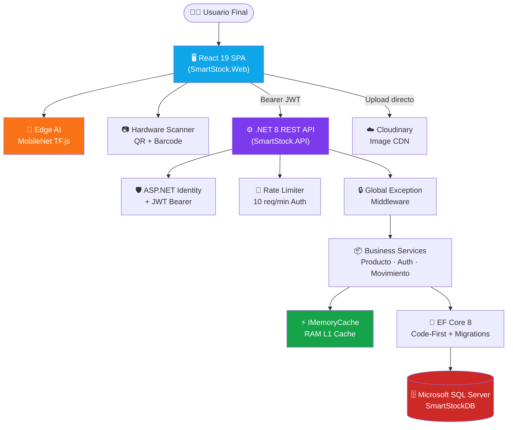
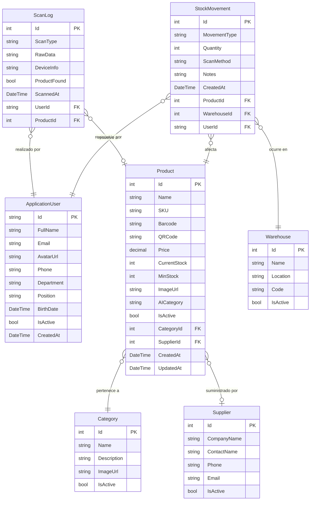

<div align="center">
  <br/>
  <a href="#">
    
  </a>

  <h1>SmartStock WMS</h1>

  <a href="https://git.io/typing-svg">
    
  </a>

  <br/><br/>

  <p>
    
    
    
    
    
    
    
    
  </p>

  <p>
    
    
    
    
    
  </p>

  <h3>🏗️ Arquitectura de Alto Rendimiento · Cero Fricción Logística</h3>
</div>

---

## 📋 Tabla de Contenidos

- [Visión General](#-visión-general)
- [Arquitectura del Sistema](#-arquitectura-del-sistema)
- [Funcionalidades Enterprise](#-funcionalidades-enterprise)
- [Estructura del Monorepo](#-estructura-del-monorepo)
- [Stack Tecnológico](#-stack-tecnológico)
- [Modelo de Datos](#-modelo-de-datos)
- [Sistema RBAC](#-sistema-rbac)
- [Instalación y Configuración](#-instalación-y-configuración)
- [API Reference](#-api-reference)
- [Autor](#-autor)

---

## 🌌 Visión General

**SmartStock WMS** es un **Sistema de Gestión de Almacenes (Warehouse Management System)** de grado empresarial, cimentado sobre una arquitectura Full-Stack moderna que combina el poder del ecosistema Microsoft .NET y la velocidad reativa de React 19.

> Mitiga los cuellos de botella en infraestructuras logísticas de alto tráfico, automatizando los flujos de inventario mediante escaneo de hardware, inteligencia artificial de borde (Edge AI), transacciones atómicas seguras y analítica estratégica en tiempo real.

**Lo que lo hace diferente:**

| Paradigma | Solución Convencional | SmartStock WMS |
|---|---|---|
| Eliminación de datos | `DELETE FROM` destructivo | Soft-Delete con ciclo de vida completo |
| Analítica | Consultas SQL directas por request | Cache L1 en RAM (IMemoryCache, 30s TTL) |
| Operaciones en masa | Bucles individuales HTTP | Batch API — N operaciones en 1 request |
| Reconocimiento de objetos | API externa costosa | Edge AI con MobileNet en el cliente |
| Seguridad | Sesiones básicas | JWT + RBAC criptográfico multinivel |
| Escaneo | Lectura manual | QR Code + Barcode con hardware nativo |

---

## 🏛️ Arquitectura del Sistema



### Pipeline de Middleware (Orden Estricto)

```
Request entrante
    ↓ GlobalExceptionMiddleware   (captura cualquier excepción no controlada)
    ↓ HTTPS Redirection
    ↓ CORS Policy (AllowReactApp)
    ↓ RateLimiter (Fixed Window)
    ↓ Authentication (JWT Bearer)
    ↓ Authorization (Role-based)
    ↓ Controller → Service → EF Core → SQL Server
    ↑ Response envuelta en JSON estándar
```

---

## 🔥 Funcionalidades Enterprise

<details>
<summary><b>🛡️ Autorización RBAC Criptográfica — 4 Niveles de Acceso</b></summary>
<br/>

El sistema utiliza **ASP.NET Core Identity** con tokens **JWT Bearer** firmados simétricamente. Cada token embebe el rol del usuario como claim, permitiendo que tanto el backend (políticas `[Authorize(Roles)]`) como el frontend (`RoleGuard.jsx`, `useAuth()`) tomen decisiones de renderizado y acceso en tiempo de ejecución.

- **Admin** → Acceso omnipotente: gestión de usuarios, restauración de entidades archivadas, cambio de roles, todas las operaciones destructivas.
- **Supervisor** → Sin capacidad hard-delete, pero sí escritura masiva: batch operations, edición de catálogos, restauración de productos y almacenes.
- **Almacenero** → Capacidad operativa de campo: registro de movimientos vía escáner, lectura de inventario, acceso al módulo de escaneo QR/Barcode.
- **Viewer** → Aislamiento read-only total: dashboard, reportes visuales y listados, sin acceso a formularios de mutación.

El seed automático en `Program.cs` garantiza que los 4 roles y un usuario `Admin` inicial existan en cada deploy.
</details>

<details>
<summary><b>🚀 Batch Operations & IMemoryCache</b></summary>
<br/>

- **Batch API** (`POST /api/Products/batch`): Procesa archivado o restauración de N productos en una sola solicitud HTTP atómica. Elimina el anti-patrón de bucles individuales N+1 que saturan el servidor en operaciones masivas.
- **Dashboard Cache** (`GET /api/Dashboard`): El endpoint calcula KPIs financieros cruzados (JOIN entre Products, Movements, Categories, Warehouses) y los almacena en la RAM del servidor durante **30 segundos** usando `IMemoryCache`. En picos de concurrencia, los usuarios comparten el mismo snapshot desde memoria sin tocar SQL Server.
</details>

<details>
<summary><b>🧠 Edge AI — MobileNet Client-Side (TensorFlow.js)</b></summary>
<br/>

El módulo `Vision.jsx` embebe el modelo pre-entrenado `@tensorflow-models/mobilenet v2.1.1` directamente en el navegador del usuario. La clasificación de imágenes de productos ocurre **100% en el cliente**:

- Sin latencia de red hacia APIs externas de visión computacional
- Sin costos de API por inferencia
- Clasificación en < 950ms sobre hardware de gama media
- Resultado devuelto como sugerencia `AICategory` que se vincula al producto
</details>

<details>
<summary><b>🔍 Scanner de Hardware — QR Code + Barcode</b></summary>
<br/>

El módulo `Scanner.jsx` usa `html5-qrcode v2.3.8` para acceder directamente a la cámara del dispositivo (mobile o desktop) y decodificar:
- Códigos **QR** generados por la propia API via `QRCoder v1.8.0`
- Códigos **de barras** (EAN-13, UPC, Code128, etc.) de productos físicos

Al detectar un código, la app dispara `POST /api/Scan` que registra el evento en `ScanLog` y resuelve el producto correspondiente, permitiendo registrar movimientos de inventario directamente desde el scanner.
</details>

<details>
<summary><b>🧾 Soft-Delete Universal & Ciclo de Vida de Entidades</b></summary>
<br/>

**Ningún dato se elimina físicamente.** Todas las entidades (`Product`, `Category`, `Supplier`, `Warehouse`) implementan el patrón **Soft-Delete**:

- `IsActive = false` → entidad "archivada" (invisible en listados normales)
- `UpdatedAt` → timestamp automático en cada modificación (auditoría forense)
- Endpoints `PUT /{id}/restore` disponibles en todos los recursos
- Toggle `includeInactive=true` en los GETs para visualizar archivados
- `ArchiveStatsBar.jsx` en el frontend muestra contadores en tiempo real de activos vs archivados
</details>

<details>
<summary><b>📊 CSV Export con BOM UTF-8</b></summary>
<br/>

Los endpoints `GET /api/Products/export` y `GET /api/Movements/export` generan archivos CSV con:
- Encoding **BOM UTF-8** (`\uFEFF`) — compatible con Microsoft Excel sin corrupción de tildes
- Filtros aplicados antes de generar (búsqueda, categoría, tipo de movimiento)
- `FileStreamResult` eficiente — sin carga completa en memoria del servidor
- Nombre dinámico con timestamp: `Inventario_SmartStock_20260407_1622.csv`
</details>

<details>
<summary><b>☁️ Cloudinary Image CDN</b></summary>
<br/>

Las imágenes de productos no se almacenan en el servidor. El frontend sube directamente a **Cloudinary** usando `VITE_CLOUDINARY_CLOUD_NAME` y `VITE_CLOUDINARY_UPLOAD_PRESET`, devolviendo una URL segura (`https://res.cloudinary.com/...`) que se persiste en el campo `ImageUrl` del producto. Esto elimina la necesidad de servir archivos estáticos desde la API.
</details>

<details>
<summary><b>🚦 Rate Limiting & Protección Anti-Fuerza Bruta</b></summary>
<br/>

Los endpoints `/api/Auth/login` y `/api/Auth/register` están protegidos con **Fixed Window Rate Limiter**:
- Máximo **10 solicitudes por minuto** por IP
- Sistema de lockout a nivel de Identity: **5 intentos fallidos → bloqueo 15 minutos**
- Respuesta estandarizada `429 Too Many Requests` con mensaje JSON
</details>

---

## 📁 Estructura del Monorepo

```text
DMS/                                  ← Raíz del repositorio (solución .NET)
├── SmartStock.sln                    ← Solución Visual Studio
│
├── SmartStock.API/                   ← 🟣 Backend REST API (.NET 8)
│   ├── Controllers/                  ← Endpoints HTTP (8 controladores)
│   │   ├── AuthController.cs         ← Login, registro, usuarios, perfil
│   │   ├── ProductsController.cs     ← CRUD + batch + export + barcode
│   │   ├── CategoriesController.cs   ← CRUD + restore
│   │   ├── SuppliersController.cs    ← CRUD + restore
│   │   ├── WarehousesController.cs   ← CRUD + restore
│   │   ├── MovementsController.cs    ← Registro de movimientos + export CSV
│   │   ├── ScanController.cs         ← Procesamiento de escaneos
│   │   └── DashboardController.cs    ← KPIs con cache L1
│   ├── Services/                     ← Business Logic Layer (8 servicios)
│   ├── Models/
│   │   ├── Entities/                 ← 7 entidades de dominio
│   │   └── DTOs/                     ← AllDTOs.cs (contratos de API)
│   ├── Data/
│   │   └── AppDbContext.cs           ← EF Core DbContext + query filters
│   ├── Middleware/
│   │   └── GlobalExceptionMiddleware.cs
│   ├── Migrations/                   ← Code-First migrations
│   ├── Program.cs                    ← Composición DI + middleware pipeline
│   └── appsettings.json              ← Configuración base
│
└── SmartStock.Web/                   ← 🔵 Frontend SPA (React 19 + Vite 8)
    ├── src/
    │   ├── pages/                    ← 13 páginas enrutadas
    │   │   ├── Dashboard.jsx         ← KPIs + gráficas Recharts
    │   │   ├── Products.jsx          ← Inventario con batch + filtros
    │   │   ├── ProductDetail.jsx     ← Detalle + QR + historial
    │   │   ├── Scanner.jsx           ← Hardware scanner QR/Barcode
    │   │   ├── Vision.jsx            ← Edge AI con TF.js MobileNet
    │   │   ├── Movements.jsx         ← Log de movimientos + export
    │   │   ├── Warehouses.jsx        ← Gestión de almacenes
    │   │   ├── Categories.jsx        ← Categorías de productos
    │   │   ├── Suppliers.jsx         ← Proveedores
    │   │   ├── Users.jsx             ← Administración de usuarios (Admin)
    │   │   ├── Profile.jsx           ← Perfil + avatar + cambio de contraseña
    │   │   ├── Labels.jsx            ← Generación de etiquetas QR
    │   │   └── Login.jsx             ← Autenticación
    │   ├── components/
    │   │   ├── layout/               ← Layout.jsx, Navbar.jsx, Sidebar.jsx
    │   │   └── ui/                   ← Toast, ConfirmModal, Pagination,
    │   │                             ←   PillToggle, ArchiveStatsBar,
    │   │                             ←   RoleGuard, SmartStockLogo
    │   ├── context/
    │   │   └── AuthContext.jsx       ← Estado global de autenticación
    │   ├── hooks/                    ← Custom React hooks
    │   ├── services/
    │   │   └── api.js                ← Cliente Axios + interceptores JWT
    │   └── index.css                 ← Sistema de diseño completo (21KB)
    ├── public/
    │   └── favicon.svg               ← Logo "H" de SmartStock
    ├── .env.example                  ← Plantilla de variables de entorno
    └── vite.config.js                ← Configuración Vite
```

---

## 🧰 Stack Tecnológico

### Backend — SmartStock.API

| Tecnología | Versión | Propósito |
|---|---|---|
| .NET / ASP.NET Core | **8.0** | Runtime y framework web |
| Entity Framework Core | **8.0** | ORM Code-First + Migrations |
| EF Core SQL Server | **8.0** | Provider Microsoft SQL Server |
| ASP.NET Core Identity | **8.0** | Gestión de usuarios y contraseñas |
| JWT Bearer | **8.0** | Autenticación stateless |
| Swashbuckle (Swagger) | **6.5.0** | Documentación OpenAPI interactiva |
| QRCoder | **1.8.0** | Generación de códigos QR en PNG/SVG |
| EF HealthChecks | **8.0** | Health endpoint `/health` |
| IMemoryCache | nativo | Cache en RAM L1 |
| Rate Limiter | nativo .NET 8 | Fixed Window anti-abuso |

### Frontend — SmartStock.Web

| Tecnología | Versión | Propósito |
|---|---|---|
| React | **19.2.4** | UI declarativa con concurrent features |
| Vite | **8.0.4** | Bundler ultrarrápido + HMR |
| React Router DOM | **7.14.0** | Enrutamiento SPA |
| Axios | **1.14.0** | HTTP client + interceptores JWT |
| TensorFlow.js | **4.22.0** | Motor de inferencia ML en navegador |
| MobileNet | **2.1.1** | Modelo de clasificación de imágenes |
| html5-qrcode | **2.3.8** | Acceso a cámara + decodificación QR/Barcode |
| Recharts | **3.8.1** | Gráficas analíticas (área, barras, pie) |
| Lucide React | **1.7.0** | Sistema de iconos SVG |
| Cloudinary | (CDN) | Almacenamiento y entrega de imágenes |

---

## 🗂️ Modelo de Datos



---

## 🔐 Sistema RBAC

| Operación | Admin | Supervisor | Almacenero | Viewer |
|---|:---:|:---:|:---:|:---:|
| Ver Dashboard y KPIs | ✅ | ✅ | ✅ | ✅ |
| Ver listado de productos | ✅ | ✅ | ✅ | ✅ |
| Crear / Editar productos | ✅ | ✅ | ✅ | ❌ |
| Archivar producto (soft-delete) | ✅ | ✅ | ✅ | ❌ |
| Restaurar producto | ✅ | ✅ | ❌ | ❌ |
| Batch operations (masivo) | ✅ | ✅ | ❌ | ❌ |
| Registrar movimientos | ✅ | ✅ | ✅ | ❌ |
| Escanear QR / Barcode | ✅ | ✅ | ✅ | ❌ |
| Gestionar categorías | ✅ | ✅ | ❌ | ❌ |
| Gestionar proveedores | ✅ | ✅ | ❌ | ❌ |
| Gestionar almacenes | ✅ | ✅ | ❌ | ❌ |
| Ver y gestionar usuarios | ✅ | ❌ | ❌ | ❌ |
| Cambiar roles de usuario | ✅ | ❌ | ❌ | ❌ |
| Activar / desactivar usuarios | ✅ | ❌ | ❌ | ❌ |
| Edge AI Vision | ✅ | ✅ | ✅ | ✅ |
| Exportar CSV | ✅ | ✅ | ✅ | ✅ |

---

## 💻 Instalación y Configuración

### Prerrequisitos

- [**.NET 8 SDK**](https://dotnet.microsoft.com/download/dotnet/8.0) — Runtime del servidor
- [**SQL Server**](https://www.microsoft.com/sql-server) — Base de datos (LocalDB / Express / Full)
- [**Node.js 19+**](https://nodejs.org/) — Runtime del cliente (npm incluido)
- [**Cuenta Cloudinary**](https://cloudinary.com/) — Para subida de imágenes (gratis)

### 🟣 Backend — SmartStock.API

**1. Configura las credenciales** en `SmartStock.API/appsettings.Development.json`:

```json
{
  "ConnectionStrings": {
    "DefaultConnection": "Server=localhost;Database=SmartStockDB;Trusted_Connection=True;TrustServerCertificate=True;"
  },
  "Jwt": {
    "Key": "TU_CLAVE_SECRETA_MINIMO_32_CARACTERES_AQUI",
    "Issuer": "SmartStock.API",
    "Audience": "SmartStock.Client",
    "ExpirationHours": 4
  },
  "AdminSeed": {
    "Email": "admin@smartstock.pe",
    "DefaultPassword": "Admin123!"
  }
}
```

**2. Ejecuta la API:**

```bash
cd SmartStock.API

# Instalar EF CLI si no lo tienes
dotnet tool install --global dotnet-ef

# Restaurar paquetes NuGet
dotnet restore

# Aplicar migraciones (crea SmartStockDB automáticamente)
dotnet ef database update

# Iniciar el servidor (seed automático de roles + admin)
dotnet run
```

> ✅ **API disponible en** `http://localhost:5000` · **Swagger UI en** `http://localhost:5000/swagger`
> 
> El seed automático crea el usuario admin: `admin@smartstock.pe` / `Admin123!`

---

### 🔵 Frontend — SmartStock.Web

**1. Configura las variables de entorno:**

```bash
cd SmartStock.Web
copy .env.example .env   # En Linux/macOS usar: cp .env.example .env
```

Edita `SmartStock.Web/.env`:

```env
VITE_API_URL=http://localhost:5000/api
VITE_CLOUDINARY_CLOUD_NAME=tu_cloud_name
VITE_CLOUDINARY_UPLOAD_PRESET=tu_upload_preset
```

**2. Instala dependencias e inicia:**

```bash
npm install
npm run dev
```

> ✅ **Aplicación disponible en** `http://localhost:5173`

---

### 🔄 Inicio Completo (Ambos Proyectos)

```bash
# Terminal 1 — Backend
cd SmartStock.API && dotnet run

# Terminal 2 — Frontend
cd SmartStock.Web && npm run dev
```

---

## 📡 API Reference

### Autenticación

| Método | Endpoint | Auth | Descripción |
|---|---|---|---|
| `POST` | `/api/Auth/login` | ❌ | Obtener JWT token |
| `POST` | `/api/Auth/register` | ❌ | Registrar usuario |
| `GET` | `/api/Auth/profile` | ✅ | Perfil del usuario autenticado |
| `PUT` | `/api/Auth/profile` | ✅ | Actualizar perfil propio |
| `POST` | `/api/Auth/change-password` | ✅ | Cambiar contraseña |
| `GET` | `/api/Auth/users` | 🔴 Admin | Listar todos los usuarios |
| `PUT` | `/api/Auth/users/{id}/role` | 🔴 Admin | Cambiar rol de usuario |
| `PUT` | `/api/Auth/users/{id}/toggle-status` | 🔴 Admin | Activar/desactivar usuario |

### Productos

| Método | Endpoint | Auth | Descripción |
|---|---|---|---|
| `GET` | `/api/Products` | ✅ | Paginado con filtros (`search`, `categoryId`, `lowStock`) |
| `GET` | `/api/Products/{id}` | ✅ | Producto por ID con QR embebido |
| `GET` | `/api/Products/barcode/{code}` | ✅ | Resolución por barcode/QR código |
| `POST` | `/api/Products` | 🟡 Admin/Sup/Alm | Crear producto |
| `PUT` | `/api/Products/{id}` | 🟡 Admin/Sup/Alm | Actualizar producto |
| `DELETE` | `/api/Products/{id}` | 🔴 Admin | Soft-delete (archivado) |
| `PUT` | `/api/Products/{id}/restore` | 🟠 Admin/Sup | Restaurar producto archivado |
| `POST` | `/api/Products/batch` | 🟠 Admin/Sup | Acción masiva (Archive/Restore) |
| `GET` | `/api/Products/export` | ✅ | Exportar CSV con filtros |

### Dashboard

| Método | Endpoint | Auth | Descripción |
|---|---|---|---|
| `GET` | `/api/Dashboard` | ✅ | KPIs + trend + low stock (cacheado 30s) |

### Movimientos

| Método | Endpoint | Auth | Descripción |
|---|---|---|---|
| `GET` | `/api/Movements` | ✅ | Log paginado con filtros |
| `POST` | `/api/Movements` | 🟡 Admin/Sup/Alm | Registrar movimiento (Entry/Exit/Transfer/Adjustment) |
| `GET` | `/api/Movements/export` | ✅ | Exportar movimientos CSV |

### Escaneo

| Método | Endpoint | Auth | Descripción |
|---|---|---|---|
| `POST` | `/api/Scan` | ✅ | Procesar escaneo (barcode/QR → producto) |
| `GET` | `/api/Scan/recent` | ✅ | Historial de escaneos del usuario |

### Catálogos (Categorías, Proveedores, Almacenes)

| Método | Endpoint | Auth | Descripción |
|---|---|---|---|
| `GET` | `/api/{Resource}` | ✅ | Listar (`includeInactive` opcional) |
| `POST` | `/api/{Resource}` | 🟡 Admin/Sup | Crear |
| `PUT` | `/api/{Resource}/{id}` | 🟡 Admin/Sup | Actualizar |
| `DELETE` | `/api/{Resource}/{id}` | 🔴 Admin | Archivar (soft-delete) |
| `PUT` | `/api/{Resource}/{id}/restore` | 🟠 Admin/Sup | Restaurar |

### Health Check

| Método | Endpoint | Auth | Descripción |
|---|---|---|---|
| `GET` | `/health` | ❌ | Estado del servidor + conexión DB |

---

<div align="center">

### Desarrollado con precisión por


</div>
