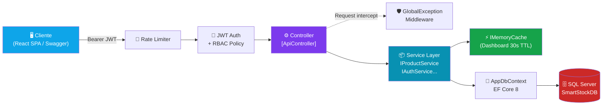

<div align="center">
  <br/>
  <a href="#">
    
  </a>

  <h1>SmartStock API</h1>

  <a href="https://git.io/typing-svg">
    
  </a>

  <br/><br/>

  <p>
    
    
    
    
    
  </p>

  <p>
    
    
    
    
    
  </p>

  <h3>⚙️ Backend REST API · Clean Architecture · Enterprise Grade</h3>
</div>

---

## 📋 Tabla de Contenidos

- [Visión General](#-visión-general)
- [Arquitectura](#-arquitectura)
- [Estructura del Proyecto](#-estructura-del-proyecto)
- [Entidades y Modelos](#-entidades-y-modelos)
- [Endpoints Completos](#-endpoints-completos)
- [Sistema de Seguridad](#-sistema-de-seguridad)
- [Configuración e Instalación](#-configuración-e-instalación)
- [Swagger / OpenAPI](#-swagger--openapi)

---

## 🌌 Visión General

**SmartStock API** es el núcleo de procesamiento de datos del sistema WMS SmartStock. Construida sobre **.NET 8** con **ASP.NET Core**, implementa una arquitectura en capas estricta que separa responsabilidades entre controladores, servicios de negocio y acceso a datos mediante Entity Framework Core.

> Cada endpoint está protegido con JWT Bearer, granulado por roles RBAC, y todas las entidades implementan Soft-Delete garantizando trazabilidad histórica completa sin pérdida de datos.

**Características técnicas clave:**

- 🔒 **ASP.NET Core Identity** — hashing bcrypt automático de contraseñas
- ⚡ **IMemoryCache** — dashboard cacheado en RAM para absorber concurrencia
- 🚦 **Rate Limiter nativo .NET 8** — protección Fixed Window en auth endpoints
- 🧩 **EF Core Code-First** — migraciones versionadas, seeds automáticos
- 📊 **Swagger UI** — exploración interactiva de todos los endpoints
- 🏥 **Health Checks** — endpoint `/health` que verifica conexión activa a SQL Server
- 📂 **BOM UTF-8 CSV** — exports Excel-safe sin corrupción de caracteres especiales

---

## 🏛️ Arquitectura

### Patrón Controller → Service → EF Core



### Pipeline de Middleware (Orden Exacto en Program.cs)

```
HTTP Request
    │
    ├─ GlobalExceptionMiddleware    → Captura excepciones → JSON estandarizado
    ├─ HTTPS Redirection
    ├─ CORS (AllowReactApp)         → Origins: :5173, :5174, :3000
    ├─ RateLimiter                  → Auth endpoints: 10 req/min
    ├─ Authentication               → Valida JWT Bearer
    ├─ Authorization                → Evalúa [Authorize(Roles="...")]
    └─ MapControllers() / MapHealthChecks()
```

### Inyección de Dependencias (DI Container)

Todos los servicios están registrados con alcance `Scoped` (un ciclo por request HTTP):

```csharp
services.AddScoped<IAuthService, AuthService>();
services.AddScoped<IProductService, ProductService>();
services.AddScoped<IDashboardService, DashboardService>();
services.AddScoped<IMovementService, MovementService>();
services.AddScoped<IScanService, ScanService>();
services.AddScoped<ICategoryService, CategoryService>();
services.AddScoped<ISupplierService, SupplierService>();
services.AddScoped<IWarehouseService, WarehouseService>();
services.AddMemoryCache(); // Singleton por diseño
```

---

## 📁 Estructura del Proyecto

```text
SmartStock.API/
│
├── Controllers/                    ← Capa de entrada HTTP
│   ├── AuthController.cs           ← 9 endpoints: login, register, profile, users
│   ├── ProductsController.cs       ← 9 endpoints: CRUD, batch, export, barcode
│   ├── CategoriesController.cs     ← 6 endpoints: CRUD + restore
│   ├── SuppliersController.cs      ← 5 endpoints: CRUD + restore
│   ├── WarehousesController.cs     ← 6 endpoints: CRUD + restore
│   ├── MovementsController.cs      ← 3 endpoints: list, create, export
│   ├── ScanController.cs           ← 2 endpoints: process, recent
│   └── DashboardController.cs      ← 1 endpoint: KPIs cacheados
│
├── Services/                       ← Business Logic Layer
│   ├── AuthService.cs              ← Identity, JWT, gestión de usuarios (8.7KB)
│   ├── ProductService.cs           ← CRUD, batch, CSV export, QR gen (9.1KB)
│   ├── DashboardService.cs         ← Analítica agregada + cache (5.9KB)
│   ├── MovementService.cs          ← Stock transactions + CSV export (6.6KB)
│   ├── ScanService.cs              ← Resolución barcode/QR → producto (2.9KB)
│   ├── CategoryService.cs          ← CRUD + soft-delete lifecycle (3.5KB)
│   ├── SupplierService.cs          ← CRUD + restore (3.7KB)
│   └── WarehouseService.cs         ← CRUD + restore (4.1KB)
│
├── Models/
│   ├── Entities/                   ← Modelos de dominio EF Core
│   │   ├── ApplicationUser.cs      ← Extiende IdentityUser con campos extra
│   │   ├── Product.cs              ← Entidad principal de inventario
│   │   ├── Category.cs             ← Clasificación de productos
│   │   ├── Supplier.cs             ← Datos del proveedor
│   │   ├── Warehouse.cs            ← Almacén físico/lógico
│   │   ├── StockMovement.cs        ← Registro de entrada/salida/transferencia
│   │   └── ScanLog.cs              ← Historial de escaneos hardware
│   └── DTOs/
│       └── AllDTOs.cs              ← Todos los contratos Request/Response (5.7KB)
│
├── Data/
│   └── AppDbContext.cs             ← DbContext + query filters globales (9.9KB)
│
├── Middleware/
│   └── GlobalExceptionMiddleware.cs ← Error handler centralizado
│
├── Migrations/                     ← Historial de migraciones EF Core
│
├── Program.cs                      ← Composición completa + seed automático
├── appsettings.json                ← Configuración base (sin secretos)
├── appsettings.Development.json    ← Secretos locales (excluido de Git)
└── SmartStock.API.csproj           ← Dependencias NuGet
```

---

## 🗃️ Entidades y Modelos

### ApplicationUser (extiende IdentityUser)

```csharp
public class ApplicationUser : IdentityUser
{
    public string FullName { get; set; }
    public string? AvatarUrl { get; set; }
    public string? Phone { get; set; }
    public string? Department { get; set; }
    public string? Position { get; set; }
    public DateTime? BirthDate { get; set; }
    public bool IsActive { get; set; } = true;
    public DateTime CreatedAt { get; set; }
}
```

### Product

```csharp
public class Product
{
    public int Id { get; set; }
    public string Name { get; set; }         // Requerido, max 200
    public string? SKU { get; set; }         // Stock Keeping Unit
    public string? Barcode { get; set; }     // EAN-13, UPC, Code128...
    public string? QRCode { get; set; }      // Base64 PNG generado por QRCoder
    public string? Description { get; set; }
    public decimal Price { get; set; }
    public int CurrentStock { get; set; }
    public int MinStock { get; set; }        // Umbral de alerta low-stock
    public string? ImageUrl { get; set; }    // URL Cloudinary CDN
    public string? AICategory { get; set; } // Sugerencia de TF.js MobileNet
    public bool IsActive { get; set; }       // Soft-delete flag
    public int CategoryId { get; set; }
    public int? SupplierId { get; set; }
    public DateTime CreatedAt { get; set; }
    public DateTime UpdatedAt { get; set; }
}
```

### StockMovement

```csharp
public class StockMovement
{
    public int Id { get; set; }
    public string MovementType { get; set; } // Entry | Exit | Transfer | Adjustment
    public int Quantity { get; set; }
    public string ScanMethod { get; set; }   // Manual | Barcode | QRCode | ImageRecognition
    public string? Notes { get; set; }
    public DateTime CreatedAt { get; set; }
    public int ProductId { get; set; }
    public int WarehouseId { get; set; }
    public string UserId { get; set; }
}
```

### DTOs Principales

<details>
<summary><b>Auth DTOs</b></summary>

```csharp
record LoginDto(string Email, string Password);
record RegisterDto(string FullName, string Email, string Password, 
                   string? Phone, string? Department, string? Position, 
                   DateTime? BirthDate, string? Role = "Viewer");
record AuthResponseDto(string Token, string RefreshToken, string UserId,
                       string FullName, string Email, string Role, DateTime Expiration,
                       string? AvatarUrl, string? Phone, string? Department, ...);
record UpdateProfileDto(string FullName, string? Phone, string? Department, 
                        string? Position, DateTime? BirthDate, string? AvatarUrl);
record ChangePasswordDto(string CurrentPassword, string NewPassword);
```
</details>

<details>
<summary><b>Product DTOs</b></summary>

```csharp
record ProductCreateDto(string Name, string? SKU, string? Barcode, string? Description,
                        decimal Price, int CurrentStock, int MinStock, 
                        string? ImageUrl, int CategoryId, int? SupplierId);
record BatchActionDto(List<int> ProductIds, string Action); // "Archive" | "Restore"
record ProductDto(int Id, string Name, string? SKU, string? Barcode, string? QRCode,
                  decimal Price, int CurrentStock, int MinStock, string? ImageUrl,
                  string? AICategory, int CategoryId, string CategoryName, ...);
record ProductListDto(int Id, string Name, decimal Price, int CurrentStock, 
                      bool IsLowStock, bool IsActive, ...);
```
</details>

<details>
<summary><b>Dashboard DTO</b></summary>

```csharp
record DashboardDto(
    int TotalProducts, int TotalCategories, int TotalWarehouses,
    int LowStockCount, int OutOfStockCount, int TodayMovements,
    decimal TotalInventoryValue,
    List<CategoryStockDto> StockByCategory,
    List<MovementDto> RecentMovements,
    List<ProductListDto> LowStockProducts,
    List<DailyMovementDto> MovementTrend  // Últimos 7 días
);
```
</details>

<details>
<summary><b>Paginación Genérica</b></summary>

```csharp
record PaginatedResponse<T>(
    List<T> Items, int TotalCount, int Page, int PageSize, int TotalPages
);
```
</details>

---

## 📡 Endpoints Completos

> Todos los endpoints protegidos requieren header: `Authorization: Bearer {token}`

### 🔑 Auth — `/api/Auth`

| Método | Ruta | Roles | Descripción |
|---|---|---|---|
| `POST` | `/login` | — | Login, devuelve JWT + datos del usuario |
| `POST` | `/register` | — | Crear cuenta (rate limited: 10/min) |
| `GET` | `/profile` | ✅ Todos | Perfil propio del usuario autenticado |
| `PUT` | `/profile` | ✅ Todos | Actualizar nombre, avatar, teléfono, etc. |
| `POST` | `/change-password` | ✅ Todos | Cambiar contraseña (verifica la actual) |
| `GET` | `/users` | 🔴 Admin | Listar todos los usuarios con roles |
| `PUT` | `/users/{id}/role` | 🔴 Admin | Asignar rol (Admin/Supervisor/Almacenero/Viewer) |
| `PUT` | `/users/{id}/toggle-status` | 🔴 Admin | Activar / desactivar cuenta |

### 📦 Products — `/api/Products`

| Método | Ruta | Roles | Descripción |
|---|---|---|---|
| `GET` | `/` | ✅ Todos | Lista paginada (`page`, `pageSize`, `search`, `categoryId`, `lowStock`, `includeInactive`) |
| `GET` | `/{id}` | ✅ Todos | Producto con QR Code embebido |
| `GET` | `/barcode/{code}` | ✅ Todos | Búsqueda directa por Barcode o QR |
| `GET` | `/export` | ✅ Todos | CSV BOM-UTF8 filtrado |
| `POST` | `/` | 🟡 Admin/Sup/Alm | Crear producto |
| `PUT` | `/{id}` | 🟡 Admin/Sup/Alm | Actualizar producto |
| `DELETE` | `/{id}` | 🔴 Admin | Soft-delete (IsActive = false) |
| `PUT` | `/{id}/restore` | 🟠 Admin/Sup | Restaurar producto archivado |
| `POST` | `/batch` | 🟠 Admin/Sup | Acción masiva: `{ productIds: [1,2,3], action: "Archive"|"Restore" }` |

### 📊 Dashboard — `/api/Dashboard`

| Método | Ruta | Roles | Descripción |
|---|---|---|---|
| `GET` | `/` | ✅ Todos | KPIs financieros + tendencia 7 días (cache 30s RAM) |

**Response example:**
```json
{
  "totalProducts": 142,
  "totalCategories": 8,
  "totalWarehouses": 4,
  "lowStockCount": 12,
  "outOfStockCount": 3,
  "todayMovements": 27,
  "totalInventoryValue": 284750.00,
  "stockByCategory": [...],
  "recentMovements": [...],
  "lowStockProducts": [...],
  "movementTrend": [
    { "date": "2026-04-01", "entries": 15, "exits": 8 },
    ...
  ]
}
```

### 🔄 Movements — `/api/Movements`

| Método | Ruta | Roles | Descripción |
|---|---|---|---|
| `GET` | `/` | ✅ Todos | Log paginado (`productId`, `warehouseId`, `movementType`) |
| `POST` | `/` | 🟡 Admin/Sup/Alm | Registrar movimiento |
| `GET` | `/export` | ✅ Todos | CSV de movimientos filtrados |

**Create Movement body:**
```json
{
  "productId": 7,
  "warehouseId": 2,
  "movementType": "Entry",
  "quantity": 50,
  "scanMethod": "Barcode",
  "notes": "Recepción lote #A-2026"
}
```

Tipos soportados: `Entry` | `Exit` | `Transfer` | `Adjustment`  
Métodos de scan: `Manual` | `Barcode` | `QRCode` | `RFID` | `ImageRecognition`

### 📷 Scan — `/api/Scan`

| Método | Ruta | Roles | Descripción |
|---|---|---|---|
| `POST` | `/` | ✅ Todos | Procesa código → resuelve producto → registra en ScanLog |
| `GET` | `/recent` | ✅ Todos | Últimos N escaneos del usuario (`?count=20`) |

**Scan body:**
```json
{
  "scanType": "QRCode",
  "rawData": "SKU-PRD-0042",
  "deviceInfo": "iPhone 15 Pro / Safari 17"
}
```

### 🏷️ Categories — `/api/Categories`

| Método | Ruta | Roles | Descripción |
|---|---|---|---|
| `GET` | `/` | ✅ Todos | Listar con conteo de productos |
| `GET` | `/{id}` | ✅ Todos | Detalle de categoría |
| `POST` | `/` | 🟠 Admin/Sup | Crear categoría |
| `PUT` | `/{id}` | 🟠 Admin/Sup | Actualizar |
| `DELETE` | `/{id}` | 🔴 Admin | Soft-delete |
| `PUT` | `/{id}/restore` | 🟠 Admin/Sup | Restaurar |

### 🚚 Suppliers — `/api/Suppliers`

| Método | Ruta | Roles | Descripción |
|---|---|---|---|
| `GET` | `/` | ✅ Todos | Listar proveedores activos (+ `includeInactive`) |
| `POST` | `/` | 🟠 Admin/Sup | Crear proveedor |
| `PUT` | `/{id}` | 🟠 Admin/Sup | Actualizar |
| `DELETE` | `/{id}` | 🔴 Admin | Archivar |
| `PUT` | `/{id}/restore` | 🟠 Admin/Sup | Restaurar |

### 🏭 Warehouses — `/api/Warehouses`

| Método | Ruta | Roles | Descripción |
|---|---|---|---|
| `GET` | `/` | ✅ Todos | Listar almacenes con `TotalMovements` |
| `GET` | `/{id}` | ✅ Todos | Almacén por ID |
| `POST` | `/` | 🟠 Admin/Sup | Crear almacén |
| `PUT` | `/{id}` | 🟠 Admin/Sup | Actualizar |
| `DELETE` | `/{id}` | 🔴 Admin | Soft-delete |
| `PUT` | `/{id}/restore` | 🟠 Admin/Sup | Restaurar |

### 🏥 Health — `/health`

```bash
curl http://localhost:5000/health
# Respuesta: {"status":"Healthy","entries":{"database":{"status":"Healthy"}}}
```

---

## 🔐 Sistema de Seguridad

### JWT Configuration

```json
{
  "Jwt": {
    "Key": "min_32_chars_secret",
    "Issuer": "SmartStock.API",
    "Audience": "SmartStock.Client",
    "ExpirationHours": 4
  }
}
```

Parámetros de validación activos:
- ✅ `ValidateIssuer` + `ValidateAudience`
- ✅ `ValidateLifetime` (expiración estricta)
- ✅ `ValidateIssuerSigningKey` (HMAC-SHA256)
- ✅ `ClockSkew = 1 minuto` (tolerancia mínima)

### Rate Limiting (Fixed Window)

```csharp
options.AddFixedWindowLimiter("AuthLimit", opt => {
    opt.PermitLimit = 10;                    // máx 10 requests
    opt.Window = TimeSpan.FromMinutes(1);    // por minuto
    opt.QueueLimit = 0;                      // sin cola
});
// Respuesta: 429 Too Many Requests
```

### Identity Password Policy

```csharp
options.Password.RequireDigit = true;
options.Password.RequiredLength = 6;
options.Password.RequireUppercase = true;
options.Lockout.MaxFailedAccessAttempts = 5;
options.Lockout.DefaultLockoutTimeSpan = TimeSpan.FromMinutes(15);
```

---

## 💻 Configuración e Instalación

### Prerrequisitos

- [**.NET 8 SDK**](https://dotnet.microsoft.com/download/dotnet/8.0)
- **Microsoft SQL Server** (LocalDB / Express / Developer Edition)

### 1. Configurar credenciales

Crea `appsettings.Development.json` (nunca lo subas a Git):

```json
{
  "ConnectionStrings": {
    "DefaultConnection": "Server=localhost;Database=SmartStockDB;Trusted_Connection=True;TrustServerCertificate=True;"
  },
  "Jwt": {
    "Key": "TuClaveSecretaDe32CaracteresMinimo!!",
    "Issuer": "SmartStock.API",
    "Audience": "SmartStock.Client",
    "ExpirationHours": 4
  },
  "AdminSeed": {
    "Email": "admin@smartstock.pe",
    "DefaultPassword": "Admin123!"
  }
}
```

### 2. Ejecutar

```bash
# Instalar EF CLI (una sola vez)
dotnet tool install --global dotnet-ef

# Restaurar paquetes
dotnet restore

# Crear / actualizar base de datos
dotnet ef database update

# Iniciar la API
dotnet run
```

> ✅ **API:** `http://localhost:5000`  
> ✅ **Swagger UI:** `http://localhost:5000/swagger`  
> ✅ **Health Check:** `http://localhost:5000/health`  
> ✅ **Admin seed:** `admin@smartstock.pe` / `Admin123!`

### 3. Publicación (Production)

```bash
dotnet publish -c Release -o ./publish
```

---

## 📖 Swagger / OpenAPI

En modo desarrollo (`ASPNETCORE_ENVIRONMENT=Development`), la API expone Swagger UI completamente configurado con soporte JWT:

1. Navega a `http://localhost:5000/swagger`
2. Haz login via `POST /api/Auth/login`
3. Copia el `token` del response
4. Click en **Authorize** → ingresa `Bearer {token}`
5. Todos los endpoints quedan desbloqueados en la UI

---

<div align="center">

### Desarrollado con precisión por


</div>
