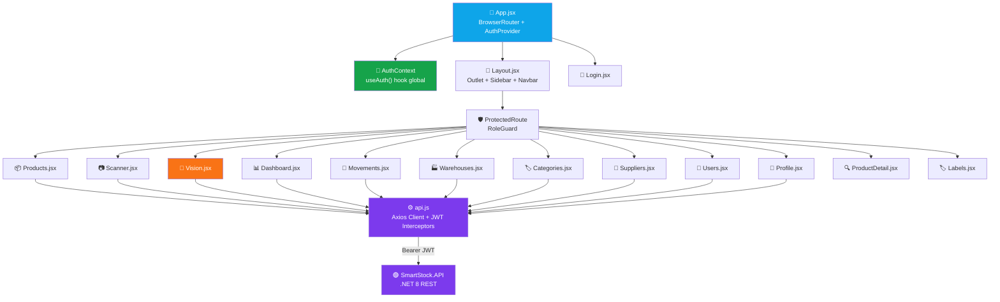

<div align="center">
  <br/>
  <a href="#">
    
  </a>

  <h1>SmartStock Web</h1>

  <a href="https://git.io/typing-svg">
    
  </a>

  <br/><br/>

  <p>
    
    
    
    
    
  </p>

  <p>
    
    
    
    
    
  </p>

  <h3>🔵 Frontend SPA · React 19 + Vite · Edge AI · Zero-Friction UX</h3>
</div>

---

## 📋 Tabla de Contenidos

- [Visión General](#-visión-general)
- [Arquitectura Frontend](#-arquitectura-frontend)
- [Páginas y Módulos](#-páginas-y-módulos)
- [Componentes Reutilizables](#-componentes-reutilizables)
- [Edge AI — MobileNet](#-edge-ai--mobilenet-tfjs)
- [Sistema RBAC Visual](#-sistema-rbac-visual)
- [API Client Layer](#-api-client-layer)
- [Instalación y Configuración](#-instalación-y-configuración)
- [Variables de Entorno](#-variables-de-entorno)

---

## 🌌 Visión General

**SmartStock Web** es el cliente SPA (Single Page Application) del sistema WMS SmartStock. Construida sobre **React 19** y **Vite 8**, integra capacidades avanzadas que van más allá de una UI tradicional:

> Una interfaz de alto rendimiento que corre inteligencia artificial directamente en el navegador del usuario, usa hardware de cámara para escanear códigos de barras y QR, adapta visualmente cada elemento según el rol del operario autenticado, y ofrece analítica financiera en tiempo real.

**Lo que hace diferente a este frontend:**

| Capacidad | Implementación |
|---|---|
| Edge AI client-side | TF.js MobileNet — clasificación de imágenes sin API externa |
| Scanner de hardware | `html5-qrcode` — acceso directo a cámara (mobile + desktop) |
| RBAC visual | `RoleGuard.jsx` + `useAuth()` — render condicional por rol |
| Dashboard analítico | Recharts — gráficas de área, barras y pie en tiempo real |
| Gestión de imágenes | Upload directo a Cloudinary CDN |
| Ciclo de vida UI | `ArchiveStatsBar` + toggles soft-delete en todos los módulos |
| Interceptores JWT | Axios interceptors — logout automático en 401 |

---

## 🏛️ Arquitectura Frontend

### Árbol de Componentes y Flujo de Datos



### Estructura del Proyecto

```text
SmartStock.Web/
│
├── public/
│   └── favicon.svg               ← Logo "H" SVG de SmartStock
│
├── src/
│   ├── App.jsx                   ← Enrutador raíz + ProtectedRoute + AppRoutes
│   ├── main.jsx                  ← Entry point React 19 + StrictMode
│   ├── index.css                 ← Design system completo (21KB, 800+ líneas)
│   │
│   ├── context/
│   │   └── AuthContext.jsx       ← Estado global: token, user, login(), logout()
│   │
│   ├── hooks/                    ← Custom React hooks
│   │
│   ├── services/
│   │   └── api.js                ← Axios instance + todos los API modules
│   │
│   ├── components/
│   │   ├── ErrorBoundary.jsx     ← Captura errores de render con fallback UI
│   │   ├── layout/
│   │   │   ├── Layout.jsx        ← Shell con Sidebar + Navbar + <Outlet/>
│   │   │   ├── Navbar.jsx        ← Topbar con perfil, notificaciones, role badge
│   │   │   └── Sidebar.jsx       ← Navegación lateral con íconos Lucide
│   │   └── ui/
│   │       ├── SmartStockLogo.jsx ← Logo vectorial SVG animado
│   │       ├── RoleGuard.jsx     ← HOC de protección de rutas por rol
│   │       ├── Toast.jsx         ← Sistema de notificaciones (success/error/info)
│   │       ├── ConfirmModal.jsx  ← Modal de confirmación destructiva
│   │       ├── Pagination.jsx    ← Paginador con elipsis inteligente
│   │       ├── PillToggle.jsx    ← Toggle pill-style para includeInactive
│   │       └── ArchiveStatsBar.jsx ← Barra de stats activos/archivados
│   │
│   └── pages/
│       ├── Login.jsx             ← Autenticación con JWT
│       ├── Dashboard.jsx         ← KPIs + Recharts + low stock alerts
│       ├── Products.jsx          ← Inventario completo (23KB — módulo principal)
│       ├── ProductDetail.jsx     ← Vista detalle + QR + historial movimientos
│       ├── Scanner.jsx           ← Hardware scanner QR/Barcode
│       ├── Vision.jsx            ← Edge AI con TF.js MobileNet
│       ├── Movements.jsx         ← Registro de movimientos + export CSV
│       ├── Warehouses.jsx        ← Gestión de almacenes + soft-delete UI
│       ├── Categories.jsx        ← Categorías de productos
│       ├── Suppliers.jsx         ← Proveedores con ciclo de vida
│       ├── Users.jsx             ← Panel Admin: roles + toggle status
│       ├── Profile.jsx           ← Self-service: avatar + datos + contraseña (19KB)
│       └── Labels.jsx            ← Generación e impresión de etiquetas QR
│
├── .env.example                  ← Plantilla de variables de entorno
├── vite.config.js               ← Configuración Vite
├── package.json                 ← Dependencias del proyecto
└── eslint.config.js             ← Reglas ESLint + React Hooks plugin
```

---

## 📄 Páginas y Módulos

### 📊 Dashboard.jsx
Centro de comando analítico del WMS. Consume `GET /api/Dashboard` (response cacheado 30s en el servidor) y renderiza:
- **KPI Cards**: Total productos, categorías, almacenes, valor del inventario
- **Alertas**: Contadores de stock bajo y productos agotados
- **Gráfica de tendencia**: Área chart de entradas vs salidas (últimos 7 días) con Recharts
- **Distribución por categoría**: Pie chart de stock por categoría
- **Tabla de low-stock**: Productos que cruzaron el umbral `MinStock`
- **Feed de movimientos recientes**: Timeline de las últimas operaciones

### 📦 Products.jsx *(Módulo principal — 23KB)*
El módulo más completo del sistema. Gestiona todo el ciclo de vida del inventario:
- **Búsqueda en tiempo real** con debounce por nombre, SKU o categoría
- **Filtros avanzados**: low stock, categoría, estado activo/inactivo
- **Batch Operations**: selección múltiple con checkboxes → Archivar/Restaurar masivo
- **Exportación CSV**: descarga directa con BOM UTF-8
- **CRUD completo**: modal de crear/editar con Cloudinary image upload
- **PillToggle**: switch para mostrar/ocultar productos archivados
- **ArchiveStatsBar**: stats en tiempo real de activos vs archivados
- **Paginación**: componente genérico con total de páginas

### 🔍 ProductDetail.jsx
Vista de producto individual enriquecida:
- Información completa con imagen Cloudinary CDN
- **Código QR generado** por la API (embebido en base64 PNG)
- Historial de movimientos de stock del producto
- Botones de acción condicionados por rol
- Navegación rápida back/next entre productos

### 📷 Scanner.jsx
Interface de hardware scanning para operarios:
- Accede a la cámara del dispositivo via `html5-qrcode`
- Decodifica **QR Codes** (generados internamente por SmartStock)
- Decodifica **códigos de barras** (EAN-13, UPC, Code128, etc.)
- Tras detectar un código → `POST /api/Scan` → resuelve al producto
- Card de producto encontrado con stock actual
- Formulario in-situ para registrar movimiento (Entry/Exit)
- Historial de escaneos recientes del usuario actual

### 🧠 Vision.jsx
Módulo de clasificación de imágenes con Edge AI:
- Carga el modelo **MobileNet v2** de TensorFlow.js directamente en el navegador
- Acepta imágenes por upload o captura de cámara
- Realiza inferencia en < 950ms sin llamadas a APIs externas
- Devuelve top-3 clasificaciones con porcentaje de confianza
- La clase ganadora se puede asignar como `AICategory` al seleccionar un producto

### 🔄 Movements.jsx
Log completo de operaciones de inventario:
- Tabla paginada con filtros por producto, almacén y tipo
- Registro de nuevo movimiento: Entry / Exit / Transfer / Adjustment
- Export a CSV para auditorías externas
- Muestra: producto, almacén, usuario, cantidad, método de escaneo, timestamp

### 👤 Profile.jsx *(Self-service — 19KB)*
Módulo de gestión del perfil propio del usuario:
- Formulario de datos personales (nombre, teléfono, departamento, cargo, fecha de nacimiento)
- **Avatar Upload** directo a Cloudinary con preview en tiempo real
- **Cambio de contraseña** seguro (verifica contraseña actual via Identity)
- Visualización del rol asignado y estado de la cuenta
- Guardado optimista con feedback Toast

### 👥 Users.jsx *(Admin only)*
Panel de administración de usuarios registrados:
- Listado con avatar, nombre, email, rol y estado
- **Toggle de estado** (Activo/Inactivo) con confirmación
- **Cambio de rol** en tiempo real (Admin/Supervisor/Almacenero/Viewer)
- Filtro por rol y búsqueda por nombre

### 🏷️ Labels.jsx
Generación de etiquetas para impresión:
- Selección de productos activos del inventario
- Renderizado de código QR listo para impresión estándar
- Diseño optimizado para etiquetas físicas de almacén

---

## 🧩 Componentes Reutilizables

### `RoleGuard.jsx`
```jsx
// Protege rutas completas por rol
<RoleGuard roles={['Admin']}>
  <Users />
</RoleGuard>

// Dentro de páginas, condiciona elementos
const { user } = useAuth();
{user?.role === 'Admin' && <button>Eliminar</button>}
```

### `Toast.jsx`
Sistema de notificaciones no bloqueante con 3 niveles:
```jsx
showToast('Producto creado exitosamente', 'success')
showToast('Error al conectar con el servidor', 'error')
showToast('Sesión por expirar en 5 minutos', 'info')
```

### `ConfirmModal.jsx`
Modal de confirmación para acciones destructivas:
```jsx
<ConfirmModal
  isOpen={showConfirm}
  title="¿Archivar producto?"
  message="Se archivará y dejará de aparecer en el inventario activo."
  onConfirm={handleDelete}
  onCancel={() => setShowConfirm(false)}
  danger
/>
```

### `Pagination.jsx`
Paginador genérico con elipsis inteligente:
```jsx
<Pagination
  page={page}
  totalPages={data.totalPages}
  onPageChange={setPage}
/>
```

### `PillToggle.jsx`
Toggle estilo pill para mostrar entidades archivadas:
```jsx
<PillToggle
  value={includeInactive}
  onChange={setIncludeInactive}
  label="Mostrar archivados"
/>
```

### `ArchiveStatsBar.jsx`
Barra de estadísticas en tiempo real:
```jsx
<ArchiveStatsBar
  activeCount={data.activeCount}
  archivedCount={data.archivedCount}
  entityName="productos"
/>
```

---

## 🧠 Edge AI — MobileNet TF.js

El módulo `Vision.jsx` implementa un **pipeline de inferencia completamente client-side**:

```javascript
// 1. Carga del modelo en el navegador (una sola vez)
import * as mobilenet from '@tensorflow-models/mobilenet';
const model = await mobilenet.load();

// 2. Clasificación de imagen (< 950ms en hardware de gama media)
const predictions = await model.classify(imageElement);
// predictions: [{ className: "backpack", probability: 0.87 }, ...]

// 3. Resultado → sugerencia AICategory para el producto
```

**Ventajas del enfoque Edge AI:**
- 🔇 **Cero llamadas a APIs de visión** (Google Vision, AWS Rekognition, etc.)
- ⚡ **Latencia < 1 segundo** para clasificación
- 🔒 **Privacidad total** — la imagen nunca sale del dispositivo
- 💰 **Costo cero** por inferencia adicional

---

## 🔐 Sistema RBAC Visual

La seguridad visual está implementada en dos capas:

### 1. `AuthContext.jsx` — Estado Global
```jsx
const { user, isAuthenticated, login, logout } = useAuth();
// user.role → "Admin" | "Supervisor" | "Almacenero" | "Viewer"
```

### 2. Renderizado Condicional por Rol

```jsx
// En Products.jsx — botones condicionados
{(user?.role === 'Admin' || user?.role === 'Supervisor') && (
  <button onClick={handleBatchArchive}>Archivar selección</button>
)}

{user?.role === 'Admin' && (
  <button onClick={handleDelete}>Eliminar permanente</button>
)}
```

### 3. Axios — Interceptor JWT Auto-Logout
```javascript
api.interceptors.response.use(
  (response) => response,
  (error) => {
    if (error.response?.status === 401) {
      // Token expirado o inválido → logout automático
      localStorage.removeItem('smartstock_token');
      localStorage.removeItem('smartstock_user');
      window.location.href = '/login';
    }
    return Promise.reject(error);
  }
);
```

---

## 🌐 API Client Layer

`src/services/api.js` centraliza **toda** la comunicación con el backend:

```javascript
// Axios instance con JWT automático
const api = axios.create({ baseURL: import.meta.env.VITE_API_URL });
api.interceptors.request.use((config) => {
  const token = localStorage.getItem('smartstock_token');
  if (token) config.headers.Authorization = `Bearer ${token}`;
  return config;
});

// Módulos exportados
export const authAPI     = { login, register, getProfile, updateProfile, changePassword, ... }
export const productsAPI = { getAll, getById, getByBarcode, create, update, delete, 
                              restore, batchAction, export }
export const categoriesAPI  = { getAll, getById, create, update, delete, restore }
export const suppliersAPI   = { getAll, create, update, delete, restore }
export const warehousesAPI  = { getAll, create, update, delete, restore }
export const movementsAPI   = { getAll, create, export }
export const scanAPI        = { process, getRecent }
export const dashboardAPI   = { get }
```

---

## 💻 Instalación y Configuración

### Prerrequisitos

- [**Node.js 19+**](https://nodejs.org/) (npm incluido)
- Backend [`SmartStock.API`](../SmartStock.API/README.md) corriendo en `localhost:5000`
- Cuenta en [**Cloudinary**](https://cloudinary.com/) (plan gratuito es suficiente)

### 1. Clonar e instalar

```bash
cd SmartStock.Web
npm install
```

### 2. Variables de entorno

```bash
# Windows
copy .env.example .env

# Linux / macOS
cp .env.example .env
```

### 3. Editar `.env`

```env
# URL de la API backend (.NET)
VITE_API_URL=http://localhost:5000/api

# Cloudinary — para upload de imágenes de productos y avatares
VITE_CLOUDINARY_CLOUD_NAME=tu_cloud_name_de_cloudinary
VITE_CLOUDINARY_UPLOAD_PRESET=tu_upload_preset_sin_firma
```

**¿Cómo obtener credenciales de Cloudinary?**
1. Registrarse en [cloudinary.com](https://cloudinary.com) (gratis)
2. Dashboard → Settings → Upload → Add upload preset (Unsigned)
3. Copiar `Cloud name` y el nombre del preset creado

### 4. Iniciar en desarrollo

```bash
npm run dev
```

> ✅ **Disponible en:** `http://localhost:5173`

### 5. Comandos disponibles

```bash
npm run dev      # Servidor de desarrollo HMR (Vite)
npm run build    # Build de producción optimizado en /dist
npm run preview  # Preview del build de producción
npm run lint     # Análisis ESLint con reglas React Hooks
```

---

## 🎨 Design System

`src/index.css` implementa un design system propio de **21KB** con:

- **Variables CSS** — paleta de colores, tipografía, spacing, radios, sombras
- **Dark mode** como modo principal (fondo `#0f172a` / `#1e293b`)
- **Componentes CSS** — cards, modales, tablas, formularios, badges, toasts
- **Animaciones** — fade-in, slide-in, spin, pulse para estados de carga
- **Responsive grid** — sidebar colapsable en mobile
- **Tipografía** — Inter (Google Fonts) como fuente principal

---

## 🔗 Rutas de la Aplicación

| Ruta | Componente | Auth requerida | Rol mínimo |
|---|---|:---:|---|
| `/login` | `Login.jsx` | ❌ | — |
| `/` | `Dashboard.jsx` | ✅ | Viewer |
| `/products` | `Products.jsx` | ✅ | Viewer |
| `/products/:id` | `ProductDetail.jsx` | ✅ | Viewer |
| `/categories` | `Categories.jsx` | ✅ | Viewer |
| `/suppliers` | `Suppliers.jsx` | ✅ | Viewer |
| `/warehouses` | `Warehouses.jsx` | ✅ | Viewer |
| `/movements` | `Movements.jsx` | ✅ | Viewer |
| `/scanner` | `Scanner.jsx` | ✅ | Almacenero |
| `/vision` | `Vision.jsx` | ✅ | Viewer |
| `/labels` | `Labels.jsx` | ✅ | Viewer |
| `/profile` | `Profile.jsx` | ✅ | Viewer |
| `/users` | `Users.jsx` | ✅ | Admin |

---

<div align="center">

### Desarrollado con precisión por


</div>
